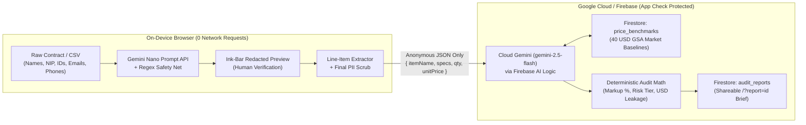

# Ghostline (AuditZero)

Whistleblower-safe public budget and procurement auditor, built for **#BuildHybridAI 2026**. **Gemini Nano (on-device)** redacts PII in the browser with **0 network requests**, and only anonymised line items cross to **Cloud Gemini + Firestore** (via Firebase AI Logic & App Check) for market price benchmarking and shareable Public Audit Briefs.

- **Live Demo:** https://auditzero-ghostline-2026.web.app
- **Team:** Denin (On-Device AI & Frontend) · Kahfi (Firebase & Cloud Audit Engine)
- **License:** [MIT](LICENSE)

## Hybrid AI Architecture



### Privacy & Financial Integrity Guarantees
- **0 PII Sent:** Raw contract text must only reach `src/services/localPipeline.js` and `src/services/localNanoService.js`. Only `result.payload` crosses to the cloud, enforced by `scrubPayload()` locally and `sanitizeCloudPayload()` before any cloud request. If redaction is ever routed through Firebase AI Logic's hybrid mode, it **must** use `ONLY_ON_DEVICE`, never `PREFER_ON_DEVICE`.
- **0 Network Requests During Redaction:** Monitored live via `PerformanceObserver` and displayed directly in the UI.
- **No LLM Arithmetic Drift:** Gemini Nano only reports PII spans (code replaces them so prices can't be altered); Cloud Gemini only performs semantic benchmark matching and forensic reasoning (code computes exact markup %, risk levels, and USD leakage totals in `src/utils/pricingAudit.js`).

## Quick Start

Requires Node.js 20+. Design rules live in [DESIGN.md](DESIGN.md).

```bash
npm install
cp .env.example .env       # Add your Firebase Web App config
npm run seed:benchmarks    # Seed 40 USD benchmarks into Firestore
npm run dev                # http://localhost:5173
```

Other scripts:

```bash
npm run build              # Production Vite build (dist/)
npm run lint               # ESLint check
npm test                   # 34 unit tests via node --test (no extra deps)
```

## Enabling Gemini Nano (On-Device)

1. Use a recent desktop Chrome (Canary/Dev recommended; ~22 GB free disk space for model download).
2. `chrome://flags/#optimization-guide-on-device-model` → **Enabled BypassPerfRequirement**
3. `chrome://flags/#prompt-api-for-gemini-nano` → **Enabled**
4. Relaunch Chrome. The header status reads **On-device · Gemini Nano**.

To verify local inference in dev mode, open DevTools Console and run:

```js
await ghostline.testNano()   // → { output, entities, ms, simulated: false }
```

While Gemini Nano is unavailable or downloading, Ghostline immediately falls back to a local pattern filter (`On-device · basic filter`) so judges on any browser can test the full workflow with zero setup. Raw text never leaves the device in either mode.

## Firebase & Cloud Audit Setup

- **Firebase Services Used:** Firebase AI Logic (`GoogleAIBackend` + `gemini-2.5-flash`), Cloud Firestore (`price_benchmarks` & `audit_reports`), Firebase App Check (`FIREBASE_APPCHECK_DEBUG_TOKEN` in dev), and Firebase Hosting.
- **1-Click Demo Mode:** Three calibrated procurement contracts (`School IT`, `Clinic medical`, `Office & classroom`) are pre-loaded in `src/data/sampleContracts.js`, alongside free-text paste and CSV upload.
- **Shareable Public Audit Briefs:** Clicking **Publish & copy share link** persists the anonymised report to Firestore `audit_reports` and generates a public `/?report=<id>` link with zero PII stored.
- **Graceful Cloud Fallback:** If Firebase env vars are not configured (e.g. a local preview), `src/services/auditHandoff.js` runs deterministic matching against the bundled `src/data/seedBenchmarks.json` and labels the mode transparently.

## Project Structure

```text
src/
├── components/
│   ├── Navbar.jsx · HybridStatusBadge.jsx   # Always-visible On-device / Cloud status
│   ├── StepRail.jsx                         # 1 Paste · 2 Redact | 3 Check prices boundary
│   ├── ContractSheet.jsx                    # Edit → Working → Redacted sheet + 3 samples + CSV
│   ├── RedactedText.jsx                     # Ink redaction bars
│   ├── HandoffPreview.jsx                   # Step 3: the only table that crosses to the cloud
│   ├── AuditResults.jsx                     # LeakageCounterCard + MarkupAlertTable + RiskTag
│   └── PublicAuditBrief.jsx                 # Executive summary, recommendations & Firestore share
├── pages/
│   ├── HomePage.jsx                         # Main 3-step hybrid audit workspace
│   └── ReportPage.jsx                       # Read-only public view for /?report=<id>
├── hooks/useNanoModel.js                    # Gemini Nano status + download progress
├── services/
│   ├── localNanoService.js                  # Chrome Prompt API: PII spans & item extraction
│   ├── localPipeline.js                     # Raw text → anonymous payload (0 network requests)
│   ├── auditHandoff.js                      # Payload → Cloud Gemini / offline benchmark handoff
│   ├── cloudAuditService.js                 # Cloud Gemini (Firebase AI Logic) anomaly engine
│   ├── auditReportService.js                # Firestore audit_reports save & share-link loader
│   ├── benchmarkService.js                  # Firestore price_benchmarks read helpers
│   └── firebase.js                          # Firebase App, App Check, Firestore & AI Logic init
├── utils/
│   ├── redaction.js · itemExtraction.js · csvParser.js
│   └── pricingAudit.js · riskLevels.js · currencyFormatter.js
├── data/
│   ├── seedBenchmarks.json                  # 40 USD GSA / public procurement price benchmarks
│   └── sampleContracts.js                   # 3 calibrated 1-click demo contracts
scripts/seedFirestore.js                     # Idempotent Firestore benchmark seeder
tests/                                       # 34 unit tests (npm test)
firebase.json · firestore.rules              # Hosting SPA config & Firestore security rules
```

## Sprint Status

| ID | Task | Owner | Status |
|----|------|-------|--------|
| T01 | Repo & React + Vite + Tailwind setup | Denin | ✅ Done |
| T02 | Verify Chrome Gemini Nano local inference | Denin | ✅ Done |
| T03 | Firebase setup (Firestore, App Check, AI Logic, Hosting) | Kahfi | ✅ Done |
| T04 | Seed Firestore with 40 USD market price benchmarks | Kahfi | ✅ Done |
| T05 | Split-screen / guided redaction UI & CSV/text input | Denin | ✅ Done |
| T06 | Gemini Nano PII redaction & JSON extraction | Denin | ✅ Done |
| T07 | Local vs. cloud & "0 PII sent" indicators | Denin | ✅ Done |
| T08 | Cloud Gemini anomaly detection & benchmark logic | Kahfi | ✅ Done |
| T09 | Sanitized JSON handoff to Cloud Gemini + Firestore | Both | ✅ Done |
| T10 | Markup alert table & total leakage counter | Denin | ✅ Done |
| T11 | Public Audit Brief view & Firestore save/share | Kahfi | ✅ Done |
| T12 | 3 realistic pre-loaded sample procurement contracts | Kahfi | ✅ Done |
| T13 | Edge-case testing & UX polish | Both | 🟡 In Progress |
| T14 | Deploy live app to Firebase Hosting | Kahfi | ✅ Live (`auditzero-ghostline-2026.web.app`) |
| T15–T18 | Demo video, final QA & #BuildHybridAI submission | Both | ⬜ Up Next |
